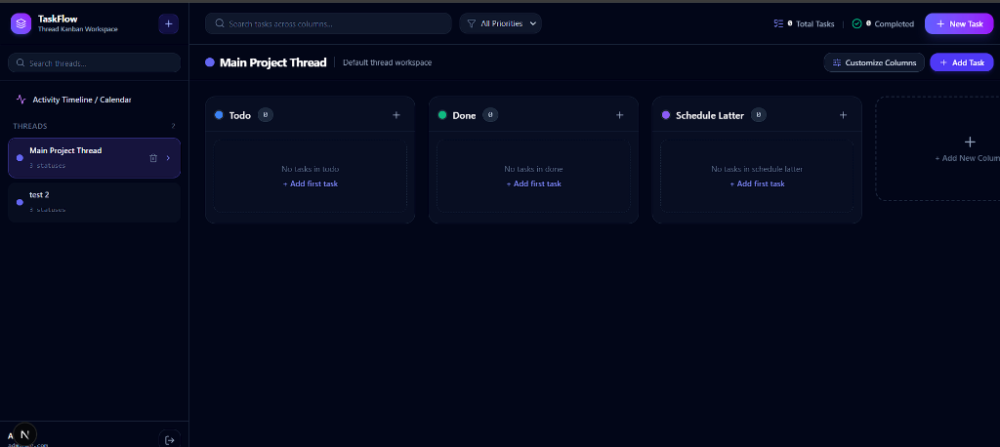

# 🚀 TaskFlow Pro (mytask) — Dynamic Thread & Kanban Task Manager

A high-performance, full-stack Task Management & Kanban workspace built with **Next.js 16 (App Router)**, **Mongoose / MongoDB**, and **dnd-kit**. Features thread-scoped task collections, dynamic custom tags/statuses per thread, O(1) fractional float drag-and-drop, constant-time `.env` authentication, and timestamped movement audit trails for calendar tracking.

---

## ⚡ 1-Click Deploy to Vercel

Deploy your own instance of TaskFlow Pro to Vercel in seconds:

[](https://vercel.com/new/clone?repository-url=https%3A%2F%2Fgithub.com%2Froushan-kr%2Fmytask&env=AUTH_EMAIL,AUTH_PASSWORD,AUTH_SECRET,MONGODB_URI&envDescription=Required%20environment%20credentials%20for%20authentication%20and%20MongoDB%20connection&envLink=https%3A%2F%2Fgithub.com%2Froushan-kr%2Fmytask%23environment-variables)

---

## 📸 Workspace Showcase



---

## ✨ Features

- 🧵 **Thread-Based Workspace**: Organize tasks across isolated threads (e.g. `Main Project Thread`, `Sprint 24`, `Mobile App`) from the left sidebar.
- 🏷️ **Dynamic Thread-Level Custom Tags (Kanban Columns)**: Each thread defines its own status workflow (`Todo`, `Done`, `Schedule Latter` or user-defined statuses) with full color customization, renaming, and safe task migration on deletion.
- 🎯 **Fractional Float Ordering**: Cards maintain order using fractional midpoints `(prev + next) / 2`, eliminating O(N) bulk updates during reordering. Includes auto-renormalization when gaps narrow.
- ⚡ **Converged Drag-and-Drop & Fast Shift**: Move tasks seamlessly via drag-and-drop or with the 1-click status dropdown selector. Both trigger the same unified mutation action.
- 🕒 **Timestamped Movement Audit Log**: Every creation, movement between columns, and status change records exact ISO timestamps (`{ action: 'moved', fromTag, toTag, timestamp }`), preparing the data model for calendar timeline views.
- 🛡️ **Constant-Time ENV Authentication**: Single-admin login verified in constant time (`crypto.timingSafeEqual`) against environment credentials with edge-compatible signed session cookies (`jose`).
- 🔄 **Optimistic UI with Rollback**: Instant fluid interface feedback on card dragging with automatic rollback if a network or server error occurs.
- 🎨 **Modern Dark Glassmorphic Aesthetic**: Designed with Tailwind CSS v4, smooth glowing gradients, and responsive layouts.

---

## 🛠️ Tech Stack

- **Framework**: [Next.js 16](https://nextjs.org/) (App Router, Server Actions, Edge Proxy)
- **Language**: [TypeScript](https://www.typescriptlang.org/)
- **Database**: [MongoDB](https://www.mongodb.com/) with [Mongoose](https://mongoosejs.com/)
- **Drag & Drop**: [@dnd-kit/core](https://dndkit.com/) & `@dnd-kit/sortable`
- **Validation**: [Zod](https://zod.dev/)
- **Authentication**: `jose` (JWT) & `crypto.timingSafeEqual`
- **Icons**: [Lucide React](https://lucide.dev/)
- **Styling**: [Tailwind CSS v4](https://tailwindcss.com/)

---

## ⚙️ Environment Variables

Create a `.env.local` file in the root of your project:

```env
# Single Admin Credentials (TimingSafe Checked)
AUTH_EMAIL="admin@taskflow.local"
AUTH_PASSWORD="admin_password_123"
AUTH_SECRET="taskflow_super_secret_jwt_key_2026_min_32_characters!"

# MongoDB Database URI (Local MongoDB or Atlas)
MONGODB_URI="mongodb://127.0.0.1:27017/taskflow"
```

---

## 🚀 Getting Started Locally

### 1. Clone the repository
```bash
git clone https://github.com/roushan-kr/mytask.git
cd mytask
```

### 2. Install dependencies
```bash
pnpm install
# or npm install / yarn install / bun install
```

### 3. Run the development server
```bash
pnpm dev
```

Open [http://localhost:3000](http://localhost:3000) in your browser and log in with the credentials set in `.env.local`.

---

## 📄 License

This project is licensed under the [MIT License](LICENSE).
